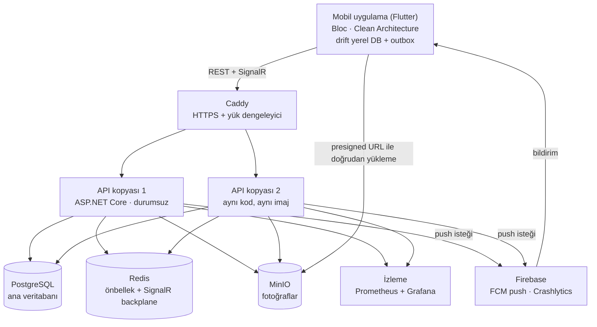

# Mimari

Bu belge sistemin parçalarını, birbirleriyle nasıl konuştuklarını ve neden bu şekilde
tasarlandıklarını anlatır. Kararların ayrıntılı gerekçeleri `docs/adr/` klasöründedir.

## 1. Genel bakış

| Parça | Görevi |
| --- | --- |
| Mobil uygulama | Kullanıcı arayüzü. İnternet yokken de çalışır; kayıtları önce telefona yazar. |
| Caddy | Tek giriş kapısı. HTTPS sağlar, istekleri API kopyalarına dağıtır. |
| API | İş kurallarının uygulandığı yer. Durumsuzdur; istediğimiz kadar kopyası çalışabilir. |
| PostgreSQL | Tüm kalıcı verinin tutulduğu ana veritabanı. |
| Redis | Sık okunan verilerin önbelleği ve SignalR mesajlarını API kopyaları arasında taşıyan köprü. |
| MinIO | Fotoğrafların tutulduğu nesne depolama (S3 uyumlu). |
| Firebase | Uygulama kapalıyken telefona push bildirim gönderir; çökme raporlarını toplar. |
| İzleme | İstek süreleri, hata oranları ve sistem sağlığını gösteren panolar. |

## 2. Önemli akışlar

### Duruş bildirimi

1. Operatör duruşu bildirir. Kayıt önce telefondaki yerel veritabanına ve gönderim kuyruğuna yazılır.
2. İnternet varsa kayıt API'ye gönderilir; yoksa bağlantı gelince otomatik gönderilir.
3. API iş kurallarını kontrol eder (yetki, tek aktif duruş) ve kaydı PostgreSQL'e yazar.
4. Aynı işlemde bir "bildirim gönder" olayı da veritabanına yazılır (transactional outbox).
5. Arka plan işçisi bu olayı alır: uygulaması açık olanlara SignalR ile, kapalı olanlara Firebase ile bildirim gönderir.

### Fotoğraf yükleme

1. Mobil uygulama API'den kısa süreli geçerli bir yükleme adresi (presigned URL) ister.
2. Fotoğrafı doğrudan MinIO'ya yükler. Büyük dosya API'den geçmez.
3. Kaydı oluştururken yalnızca fotoğrafın yolunu API'ye gönderir.

## 3. Backend katmanları (Clean Architecture)

| Katman | İçinde ne var | Neye bağımlı |
| --- | --- | --- |
| Domain | Varlıklar, durum makineleri, iş kuralları | Hiçbir şeye |
| Application | Kullanım senaryoları, arayüzler, doğrulama | Domain |
| Infrastructure | EF Core, Redis, MinIO, Firebase, Hangfire bağlantıları | Application, Domain |
| Api | Controller'lar, SignalR hub'ları, kimlik doğrulama | Hepsini birleştirir |

Bağımlılıklar her zaman **içe doğrudur**: iş kuralları veritabanını ya da arayüzü bilmez.
Bu kural mimari testlerle (NetArchTest) korunur.

## 4. Modüller (modüler monolit)

Backend tek bir uygulama olarak çalışır, ama içinde birbirinden ayrılmış beş modül vardır:

| Modül | Sahibi olduğu veri |
| --- | --- |
| Identity | Kullanıcılar, roller, refresh token'lar |
| Organization | Fabrika, bölüm, hat, makine, QR kodları |
| Andon | Duruşlar, eskalasyon kayıtları |
| Kaizen | Öneriler, onay geçmişi, kazanımlar |
| FiveS | Denetim şablonları ve versiyonları, denetimler, bulgular |

**Kurallar:**

- Bir modül başka bir modülün tablolarına doğrudan erişmez; o modülün arayüzünü çağırır ya da olayını dinler.
- Bir işlem tek bir modülün verisini değiştirir. Modüller arası etkiler olaylarla gerçekleşir.
- `SharedKernel` küçük tutulur ve iş kuralı içermez.

## 5. Mobil katmanları

Her özellik (`auth`, `andon`, `kaizen`, `audit_5s`, `dashboard`) kendi klasöründe üç katmana ayrılır:

| Katman | İçinde ne var |
| --- | --- |
| Presentation | Ekranlar, widget'lar, Bloc'lar |
| Domain | Varlıklar ve kullanım senaryoları (saf Dart) |
| Data | Repository'ler, API istemcisi, yerel veritabanı |

## 6. Güvenilirlik ilkeleri

- **Gerçek durum her zaman PostgreSQL'dedir.** SignalR mesajı yalnızca "bir şey değişti" haberidir; kaybolursa uygulama yeniden bağlanınca güncel durumu sunucudan çeker.
- **Hiçbir işlem iki kez uygulanmaz.** Her istek benzersiz bir işlem kimliği taşır; sunucu aynı kimliği ikinci kez görürse işlemi tekrarlamaz (idempotency).
- **Eşzamanlı değişiklikler sessizce ezilmez.** İki kişi aynı kaydı aynı anda değiştirirse ikincisi 409 Conflict alır (optimistic concurrency).
